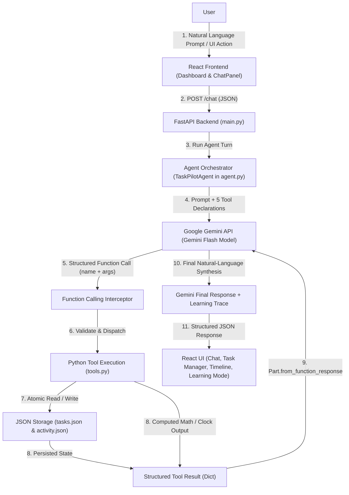

# TaskPilot — Agentic AI Mission Control & Function-Calling Workspace

[](https://www.python.org/)
[](https://fastapi.tiangolo.com/)
[](https://ai.google.dev/)
[](https://react.dev/)
[](https://vite.dev/)
[](https://tailwindcss.com/)
[](#18-testing-instructions)

**TaskPilot** is a full-stack AI Agent application engineered to demonstrate how modern Large Language Models transition from passive text generators into **autonomous, tool-using agents**. Built with **Python + FastAPI**, the official **Google Gemini (`google-genai`) SDK**, and a dark-mode **React + Vite + Tailwind CSS** dashboard, TaskPilot interprets natural-language goals, selects and executes validated backend Python functions, enforces human-in-the-loop approval for destructive operations, and exposes every reasoning and tool-execution step through an interactive **Learning Mode**.

---

## Table of Contents

1. [Project Title & Introduction](#taskpilot--agentic-ai-mission-control--function-calling-workspace)
2. [Project Overview](#2-project-overview)
3. [Problem Statement](#3-problem-statement)
4. [Key Features & Implementation Audit](#4-key-features--implementation-audit)
5. [AI Agent Architecture](#5-ai-agent-architecture)
6. [Mermaid Architecture Diagram](#6-mermaid-architecture-diagram)
7. [Gemini Function-Calling Workflow](#7-gemini-function-calling-workflow)
8. [The Agent Execution Loop](#8-the-agent-execution-loop)
9. [Available Agent Tools](#9-available-agent-tools)
10. [Technology Stack](#10-technology-stack)
11. [Project Directory Structure](#11-project-directory-structure)
12. [Installation Instructions (Windows)](#12-installation-instructions-windows)
13. [Gemini API Key Configuration](#13-gemini-api-key-configuration)
14. [Backend Startup Instructions](#14-backend-startup-instructions)
15. [Frontend Startup Instructions](#15-frontend-startup-instructions)
16. [API Endpoint Documentation](#16-api-endpoint-documentation)
17. [Example Interactions](#17-example-interactions)
18. [Testing Instructions](#18-testing-instructions)
19. [Security Considerations](#19-security-considerations)
20. [Limitations](#20-limitations)
21. [Future Improvements](#21-future-improvements)
22. [Learning Objectives](#22-learning-objectives)
23. [Screenshots & Demonstration](#23-screenshots--demonstration)

---

## 2. Project Overview

Most introductory AI projects stop at wrapping an LLM chat completion endpoint. While useful for drafting text, a standalone LLM cannot:
- Know the current system clock or local timezone.
- Perform guaranteed-accurate multi-step arithmetic without hallucination risk.
- Read, create, update, or delete records in persistent storage.
- Pause execution to ask a human operator for permission before performing a destructive action.

**TaskPilot** bridges this gap by pairing a **Google Gemini Flash** model with a deterministic **Python tool runtime** and an observable **Mission Control UI**. Every prompt sent to TaskPilot can trigger zero, one, or a chained sequence of backend tool executions—complete with per-step latency telemetry, JSON payload inspection, and beginner-friendly educational annotations.

---

## 3. Problem Statement

Developers learning AI engineering often face two obstacles:
1. **Black-Box Abstractions:** Heavyweight agent frameworks frequently hide the underlying tool declaration schemas, `function_call` payloads, and `function_response` message turns, making it difficult to understand how an LLM actually orchestrates tools.
2. **Unsafe Execution Patterns:** Naive agent prototypes often rely on unrestricted `eval()` for math or allow the model to execute destructive actions (such as deleting data) without human confirmation.

**TaskPilot** solves both problems by implementing a transparent, from-scratch agent execution loop directly on top of the official `google-genai` SDK, paired with AST-validated tools, atomic JSON persistence, human-in-the-loop safety gates, and a real-time **Learning Mode** inspector.

---

## 4. Key Features & Implementation Audit

| Feature Category | Capability | Status | Implementation Details |
| :--- | :--- | :--- | :--- |
| **Gemini Agent Core** | Official `google-genai` SDK Function Calling | **Fully Implemented** | Uses `types.Tool` & `types.FunctionDeclaration` in `backend/tools.py` and `client.models.generate_content` in `backend/agent.py`. |
| **Dynamic Model Selection** | Auto-discovery of current Gemini Flash model | **Fully Implemented** | `TaskPilotAgent.resolve_model()` queries `client.models.list()` and prioritizes `gemini-2.5-flash` / `gemini-flash-latest`. |
| **Multi-Tool Chaining** | Iterative tool-calling loop (`MAX_TOOL_ITERATIONS = 6`) | **Fully Implemented** | Feeds `types.Part.from_function_response` back into conversation history across up to 6 turns. |
| **Tool 1: Calculator** | Safe mathematical evaluation without `eval()` | **Fully Implemented** | AST parser (`ast.parse(..., mode="eval")`) with strict operator, function, and exponent allowlists. |
| **Tool 2: Add Task** | Create and persist tasks with deadlines | **Fully Implemented** | Validates inputs, assigns sequential `TSK-XXXX` IDs, and writes atomically to `data/tasks.json`. |
| **Tool 3: View Tasks** | Retrieve tasks with status filtering | **Fully Implemented** | Supports `all`, `active`, and `completed` filters with summary counters. |
| **Tool 4: Delete Task** | Delete task by ID with human approval | **Fully Implemented** | Ignores model-forged confirmation flags; pauses execution until the user approves via UI. |
| **Tool 5: System Clock** | Retrieve live system date, time, weekday & timezone | **Fully Implemented** | Queries `datetime.now().astimezone()` for accurate relative-deadline resolution. |
| **Educational Mode** | **LEARNING MODE** behind-the-scenes inspector | **Fully Implemented** | Native HTML `<input type="checkbox" switch>` toggles detailed step-by-step explanations of intent, arguments, Python execution, and synthesis. |
| **Activity Timeline** | Visual execution pipeline & trace history | **Fully Implemented** | Persists up to 100 execution traces in `data/activity.json` and renders horizontal & vertical timelines. |
| **Response Streaming** | Progressive text reveal in Chat UI | **Partially Implemented** | Backend returns the complete structured JSON turn (`POST /chat`) and the React UI (`StreamingText` in `ChatPanel.jsx`) progressively reveals the response client-side rather than via Server-Sent Events (SSE). |

---

## 5. AI Agent Architecture

TaskPilot is architected around five cleanly separated layers:

1. **React Frontend (`taskpilot/frontend/src/`)**
   - Renders the dark futuristic Mission Control dashboard, manages user interactions, displays expandable tool execution cards, enforces confirmation modals via native HTML `<dialog>`, and renders the **Learning Mode** educational breakdown.
2. **FastAPI Backend (`taskpilot/backend/main.py`)**
   - Exposes RESTful asynchronous endpoints (`POST /chat`, `GET /tasks`, `POST /tasks`, `PATCH /tasks/{task_id}`, `DELETE /tasks/{task_id}`, `GET /activity`, `GET /health`), validates payloads with Pydantic v2 models, and manages CORS.
3. **Agent Orchestrator & LLM Brain (`taskpilot/backend/agent.py` + Google Gemini API)**
   - `TaskPilotAgent` constructs the system instruction, attaches the 5 `FunctionDeclaration` schemas, sends the conversation history to the Gemini Flash model, inspects returned `function_calls`, coordinates tool execution, and returns `Part.from_function_response` objects back to Gemini until a final natural-language answer is produced.
4. **Validated Tool Runtime (`taskpilot/backend/tools.py`)**
   - Acts as the deterministic execution layer. Validates every argument passed by Gemini, executes safe Python logic (AST math, datetime lookup, task CRUD), and enforces the human-in-the-loop security boundary on `delete_task`.
5. **Persistent JSON Storage (`taskpilot/backend/storage.py`)**
   - Provides thread-safe (`threading.Lock`) and atomic (`.tmp` write-then-replace) persistence for tasks (`data/tasks.json`) and agent execution traces (`data/activity.json`).

---

## 6. Mermaid Architecture Diagram



---

## 7. Gemini Function-Calling Workflow

Unlike prompt-hacked JSON parsing, TaskPilot uses **native Gemini Function Calling** via the `google-genai` SDK:

1. **Schema Registration:** Each Python function in `taskpilot/backend/tools.py` is paired with a `types.FunctionDeclaration` containing a strict `types.Schema` (defining parameter types, descriptions, enum constraints, and required fields).
2. **Intent & Parameter Extraction:** When `client.models.generate_content()` is called with `config=types.GenerateContentConfig(tools=[GEMINI_TOOL_DECLARATIONS], temperature=0.2)`, Gemini decides whether the user's request requires external data or state mutation.
3. **Structured Invocation:** If a tool is needed, Gemini populates `response.function_calls` with one or more `FunctionCall(name=..., args={...})` objects instead of guessing an answer.
4. **Result Injection:** The Python backend executes each requested function, wraps the returned dictionary in `types.Part.from_function_response(name=tool_name, response=tool_result)`, and appends both the model's `function_call` turn and the `function_response` turn to `contents`.
5. **Natural-Language Grounding:** Gemini reads the exact dictionary returned by Python and composes a grounded final response.

---

## 8. The Agent Execution Loop

The core orchestration loop in `TaskPilotAgent.run()` (`taskpilot/backend/agent.py`) follows a strict 9-step lifecycle bounded by `MAX_TOOL_ITERATIONS = 6`:

```text
Step 1: Receive natural-language user request (and any human-confirmed delete IDs)
Step 2: Append recent conversation history and send to Gemini with tool schemas
Step 3: Inspect Gemini response for function_calls
        ├── If NO function_calls:
        │     Step 9: Extract final natural-language answer, record timeline, and return
        └── If function_calls present (Iteration <= 6):
              Step 4: Log selected tool(s) to the Execution Timeline
              Step 5: Extract and validate JSON arguments
              Step 6: Execute tool via tools.execute_tool() in Python
              Step 7: Package output into types.Part.from_function_response()
              Step 8: Append to conversation contents and continue loop
```

Because the loop feeds tool outputs back to Gemini on each iteration, the agent can perform **multi-step reasoning chains** automatically:
- *"Delete the sprint budget task"* → Iteration 1 calls `view_tasks` to discover that `"Prepare sprint budget estimate"` has ID `TSK-1003` → Iteration 2 calls `delete_task(task_id="TSK-1003")` → Pauses for human confirmation.
- *"Check today's date, compute 18% of 2450, and add a task to pay it tomorrow"* → Iteration 1 calls `get_current_datetime` and `calculator` → Iteration 2 calls `add_task` with the resolved date and calculated amount → Iteration 3 outputs the final summary.

---

## 9. Available Agent Tools

All 5 tools are implemented in `taskpilot/backend/tools.py`:

| Tool Identifier | Parameters | Return Payload | Safety & Validation Controls |
| :--- | :--- | :--- | :--- |
| `calculator` | `expression: str` | `{ success, expression, normalized_expression, result }` | Parses expressions via Python `ast.parse(mode="eval")`. Allows only arithmetic operators (`+`, `-`, `*`, `/`, `//`, `%`, `**`), constants (`pi`, `e`), and whitelisted `math` functions (`sqrt`, `sin`, `cos`, `tan`, `log`, `log10`, `exp`, `abs`, `round`, `ceil`, `floor`, `min`, `max`, `pow`). Rejects exponents `> 1000`, division by zero, and any attribute/import access. |
| `add_task` | `name: str`, `deadline: str` | `{ success, message, task }` | Enforces non-empty task names (`<= 200` chars) and deadlines (`<= 100` chars). Generates unique `TSK-XXXX` IDs and persists atomically to `data/tasks.json`. |
| `view_tasks` | `status: str = "all"` | `{ success, filter, count, total_active, total_completed, tasks }` | Validates `status` against `all`, `active`, and `completed` filters. |
| `delete_task` | `task_id: str`, `confirmed: bool = False` | `{ success, requires_confirmation, status, task, message }` | Verifies task existence first. **Security Gate:** `execute_tool()` ignores any `confirmed=True` argument generated by the LLM and only sets `confirmed=True` when the task ID is present in the backend's human-verified `confirmed_delete_ids` set. |
| `get_current_datetime` | *(none)* | `{ success, iso, date, time, readable, weekday, timezone }` | Queries the host system clock with local timezone awareness. |

---

## 10. Technology Stack

### Backend
- **Language:** Python 3.11+ (tested on Python 3.14.7)
- **Web Framework:** FastAPI (`>=0.115.0`) + Uvicorn ASGI Server (`>=0.30.0`)
- **AI SDK:** Official Google GenAI SDK (`google-genai >= 1.0.0`)
- **Validation & Settings:** Pydantic v2 (`>=2.0.0`) + `python-dotenv` (`>=1.0.0`)
- **Testing:** Pytest (`>=8.0.0`)

### Frontend
- **Framework:** React 19 (`^19.1.0`) + Vite 6 (`^6.3.2`)
- **Styling:** Tailwind CSS v4 (`@tailwindcss/vite ^4.1.4`)
- **Icons:** Lucide React (`^1.16.0`)
- **Modern Web Standards:** Native HTML `<dialog>` (`showModal()`), native `<input type="checkbox" switch>`, IME-safe `Enter` submission, and CSS `scrollbar-color` / `scrollbar-width`.

---

## 11. Project Directory Structure

```text
Task assistant/
├── README.md                          # Comprehensive root documentation
├── .gitignore                         # Root Git exclusion rules
├── pytest.ini                         # Pytest configuration (-p no:locust)
├── assets/                            # Application screenshots & placeholders
│   └── README.md
└── taskpilot/
    ├── README.md                      # Package-level documentation
    ├── .gitignore                     # Project Git exclusion rules
    ├── assets/
    │   └── README.md
    ├── backend/
    │   ├── main.py                    # FastAPI application & REST endpoints
    │   ├── agent.py                   # TaskPilotAgent & Gemini tool-calling loop
    │   ├── tools.py                   # 5 validated Python tools & FunctionDeclarations
    │   ├── storage.py                 # Thread-safe atomic JSON persistence layer
    │   ├── test_backend.py            # Automated pytest verification suite (7 tests)
    │   ├── requirements.txt           # Python dependencies
    │   ├── pytest.ini                 # Pytest configuration
    │   ├── .env.example               # Template for GEMINI_API_KEY configuration
    │   └── data/
    │       ├── tasks.json             # Persistent task storage
    │       └── activity.json          # Persistent execution timeline traces
    └── frontend/
        ├── index.html                 # HTML entry point & Google Fonts
        ├── package.json               # Node dependencies & scripts
        ├── vite.config.js             # Vite bundler & API proxy configuration
        └── src/
            ├── main.jsx               # React DOM root mount
            ├── App.jsx                # Root application wrapper
            ├── index.css              # Tailwind CSS v4, custom scrollbars, dialog rules
            ├── services/
            │   └── api.js             # Fetch client for FastAPI endpoints
            ├── pages/
            │   └── Dashboard.jsx      # Main Mission Control state & layout orchestrator
            └── components/
                ├── Header.jsx         # Agent status badge, metrics & Learning Mode switch
                ├── ChatPanel.jsx      # Agent chat console, tool cards & approval gate
                ├── TaskManager.jsx    # Task CRUD list & filter tabs
                ├── ActivityTimeline.jsx # Step-by-step execution pipeline visualizer
                ├── LearningModePanel.jsx # Behind-the-scenes educational breakdown
                └── DeleteConfirmDialog.jsx # Native HTML <dialog> confirmation modal
```

---

## 12. Installation Instructions (Windows)

### Prerequisites
- **Python 3.11 or newer** (`python --version`)
- **Node.js 18 or newer** and **npm** (`node --version` & `npm --version`)
- **Google Gemini API Key** from [Google AI Studio](https://aistudio.google.com/apikey)

### Step 1: Clone the Repository
```powershell
git clone https://github.com/BankaiBash/TaskPilot-AI-Agent.git
cd TaskPilot-AI-Agent
```

### Step 2: Set Up the Python Virtual Environment & Backend Dependencies
```powershell
cd taskpilot\backend
python -m venv venv
.\venv\Scripts\Activate.ps1
python -m pip install -r requirements.txt
```

### Step 3: Install Frontend Dependencies
```powershell
cd ..\frontend
npm install
```

---

## 13. Gemini API Key Configuration

TaskPilot reads your Gemini API key exclusively from backend environment variables and **never exposes it to the React frontend**.

1. In `taskpilot\backend\`, copy `.env.example` to `.env`:
   ```powershell
   Copy-Item .env.example .env
   ```
2. Open `taskpilot\backend\.env` in your editor and set `GEMINI_API_KEY`:
   ```env
   # Google Gemini API Key (Get one at https://aistudio.google.com/apikey)
   GEMINI_API_KEY=your_actual_gemini_api_key_here

   # Optional: Override default Gemini Flash model (auto-detected if left blank)
   # GEMINI_MODEL=gemini-2.5-flash

   # Backend server port
   PORT=8000
   ```
   > **Note:** `agent.py` reloads `.env` dynamically on requests, so adding or updating your key in `taskpilot/backend/.env` takes effect immediately without restarting the server.

---

## 14. Backend Startup Instructions

From a PowerShell terminal in `taskpilot\backend\`:

```powershell
cd taskpilot\backend
.\venv\Scripts\Activate.ps1
python main.py
```

- **Backend Base URL:** `http://127.0.0.1:8000`
- **Interactive Swagger UI:** `http://127.0.0.1:8000/docs`
- **Health Check Endpoint:** `http://127.0.0.1:8000/health`

---

## 15. Frontend Startup Instructions

Open a second PowerShell terminal in `taskpilot\frontend\`:

```powershell
cd taskpilot\frontend
npm run dev
```

- **Frontend Dashboard URL:** `http://localhost:5173`
- To build the optimized production bundle:
  ```powershell
  npm run build
  ```

---

## 16. API Endpoint Documentation

### `GET /health`
Returns service health and current agent configuration state.
```json
{
  "status": "ok",
  "agent": {
    "agent_name": "TaskPilot Core v1.0",
    "status": "online",
    "api_key_configured": true,
    "model": "gemini-2.5-flash",
    "sdk": "google-genai",
    "max_iterations": 6,
    "available_tools": ["calculator", "add_task", "view_tasks", "delete_task", "get_current_datetime"]
  }
}
```

### `POST /chat`
Processes a natural-language user prompt through the Gemini agent loop.
- **Request Body:**
  ```json
  {
    "message": "Calculate (240 * 15) + 400 and add a task to submit that budget tomorrow at 5 PM",
    "history": [],
    "confirmed_delete_ids": []
  }
  ```
- **Response (`200 OK`):** Returns `request_id`, `success`, `response` (final markdown text), `model`, `iterations`, `tool_calls` (array of executed tools with arguments, outputs, and latency), `timeline` (step-by-step trace), `pending_confirmations`, `learning_mode` (educational breakdown), and `duration_ms`.

### `GET /tasks`
Retrieves stored tasks. Accepts optional query parameter `?status=all|active|completed`.
- **Response (`200 OK`):**
  ```json
  {
    "success": true,
    "filter": "all",
    "count": 3,
    "active_count": 2,
    "completed_count": 1,
    "total_count": 3,
    "tasks": [
      {
        "id": "TSK-1001",
        "name": "Review Gemini Function Calling Documentation",
        "deadline": "2026-11-05 18:00",
        "completed": true,
        "created_at": "2026-11-02T10:00:00"
      }
    ]
  }
  ```

### `POST /tasks`
Creates a task directly from the UI Task Manager.
- **Request Body:** `{ "name": "Deploy FastAPI server", "deadline": "2026-11-06 09:00" }`
- **Response (`201 Created`):** `{ "success": true, "message": "...", "task": { ... } }`

### `PATCH /tasks/{task_id}`
Updates task completion state, name, or deadline.
- **Request Body:** `{ "completed": true }`
- **Response (`200 OK`):** `{ "success": true, "message": "...", "task": { ... } }`

### `DELETE /tasks/{task_id}?confirmed=true`
Deletes a task by ID. Returns `400 Bad Request` with `requires_confirmation: true` if `confirmed=true` is omitted.
- **Response (`200 OK`):** `{ "success": true, "message": "...", "deleted_task": { ... } }`

### `GET /activity`
Returns agent status, task counters (`active_tasks`, `completed_tasks`, `total_tasks`), and recent execution timelines (`?limit=25`).

---

## 17. Example Interactions

### Example 1: Safe Mathematical Calculation
> **User:** `"Calculate (1850 * 1.18) + sqrt(256) and explain the breakdown."`
- **Agent Action:** Selects `calculator(expression="(1850 * 1.18) + sqrt(256)")`.
- **Python Execution:** AST evaluator computes `2183 + 16 = 2199` in `<1ms` without `eval()`.
- **Final Response:** Explains that $1850 \times 1.18 = 2183$, $\sqrt{256} = 16$, and the total is **2,199**.

### Example 2: Multi-Tool Chaining (Clock + Math + Task Persistence)
> **User:** `"Check today's date, calculate 15% of 4800, and add a task to review that budget tomorrow at 4:00 PM."`
- **Iteration 1:** Gemini calls `get_current_datetime()` and `calculator(expression="0.15 * 4800")`.
- **Iteration 2:** After receiving the current date (`2026-11-02`) and calculation result (`720`), Gemini calls `add_task(name="Review budget of 720", deadline="2026-11-03 16:00")`.
- **Iteration 3:** Gemini confirms the new task ID (`TSK-1004`) and deadline.

### Example 3: Human-in-the-Loop Destructive Deletion
> **User:** `"Delete task TSK-1002"`
- **Iteration 1:** Gemini calls `delete_task(task_id="TSK-1002")`.
- **Safety Gate:** Python sees `TSK-1002` is not yet in `confirmed_delete_ids`, refuses to delete the record from `tasks.json`, and returns `requires_confirmation: true`.
- **UI Prompt:** The Chat Console renders a rose-accented **Human Confirmation Required** card with **Approve & Delete TSK-1002** and **Cancel** buttons. Only after clicking **Approve & Delete** is `confirmed_delete_ids: ["TSK-1002"]` sent to complete the deletion.

---

## 18. Testing Instructions

TaskPilot includes an automated `pytest` suite in `taskpilot/backend/test_backend.py` covering all 5 tools, AST security guards, multi-tool agent loop chaining, human confirmation gates, maximum iteration limits, and all FastAPI endpoints.

Run the test suite from the repository root:

```powershell
python -m pytest taskpilot/backend/test_backend.py -v
```

### Verified Test Results
```text
============================= test session starts =============================
collected 7 items

taskpilot/backend/test_backend.py::test_calculator_tool_safe_and_accurate PASSED [ 14%]
taskpilot/backend/test_backend.py::test_task_crud_and_confirmation_guard PASSED [ 28%]
taskpilot/backend/test_backend.py::test_current_datetime_tool PASSED     [ 42%]
taskpilot/backend/test_backend.py::test_agent_multi_tool_execution_loop_and_learning_mode PASSED [ 57%]
taskpilot/backend/test_backend.py::test_agent_destructive_delete_requires_human_approval PASSED [ 71%]
taskpilot/backend/test_backend.py::test_agent_max_iteration_limit PASSED [ 85%]
taskpilot/backend/test_backend.py::test_fastapi_endpoints PASSED         [100%]

============================== 7 passed in 1.14s ==============================
```

---

## 19. Security Considerations

1. **Zero Secret Exposure:** `GEMINI_API_KEY` is loaded server-side via `python-dotenv` and never sent to or stored in the frontend bundle. `.env` files are strictly excluded via `.gitignore`.
2. **No `eval()` Execution:** The `calculator` tool parses expressions into an Abstract Syntax Tree (`ast.parse`) and only evaluates explicitly whitelisted numeric constants, operators, and `math` functions. Code injection attempts (such as `__import__('os').system(...)`) and resource-exhaustion exponents (`10 ** 5000`) are rejected deterministically.
3. **Server-Enforced Human Approval:** Even if a prompt injection attempts to trick the LLM into passing `delete_task(task_id="TSK-1001", confirmed=True)`, `tools.execute_tool()` strips the model's `confirmed` argument and checks the server-side `confirmed_delete_ids` set populated only by explicit user confirmation.
4. **Loop Termination Guard:** `MAX_TOOL_ITERATIONS = 6` prevents runaway tool-calling loops and unbounded API token consumption.

---

## 20. Limitations

- **Local JSON Storage:** Tasks and activity logs are stored in local JSON files (`data/tasks.json` and `data/activity.json`). While protected by a thread lock and atomic file replacement, this is designed for single-instance local use rather than high-concurrency distributed deployments.
- **Single-User Workspace:** Authentication and multi-tenant user isolation are not included in this initial version.
- **Simulated Client-Side Text Streaming:** The `/chat` endpoint awaits the full tool-calling loop before returning the structured JSON payload, and the frontend progressively reveals the final response text rather than streaming raw SSE tokens mid-loop.

---

## 21. Future Improvements

- **Server-Sent Events (SSE) / WebSocket Streaming:** Stream intermediate tool-selection events and final response tokens in real time as each loop iteration completes.
- **SQLite / PostgreSQL Storage Backend:** Migrate `storage.py` to SQLAlchemy / SQLite for relational querying, pagination, and full-text search across large task histories.
- **Additional Agent Tools:** Add calendar `.ics` export, priority tagging, recurring task schedules, and web search grounding.
- **Voice Command Input:** Integrate Web Speech API / multimodal audio input for hands-free task management.

---

## 22. Learning Objectives

By building and inspecting **TaskPilot**, you learn:
1. **LLM vs. Agent Distinction:** Why an LLM alone is a reasoning engine and how tools + an execution loop turn it into an agent.
2. **Structured Function Declarations:** How to design JSON schemas (`types.FunctionDeclaration`) that guide Gemini to produce reliable function arguments.
3. **Multi-Turn Tool Loops:** How `types.Part.from_function_call` and `types.Part.from_function_response` maintain conversational state across multi-tool chains.
4. **Defensive AI Engineering:** How to sandbox tool inputs with AST parsing, enforce human-in-the-loop confirmation gates, and cap iteration counts.

---

## 23. Screenshots & Demonstration

> **Note:** Genuine live screenshots can be saved to the [`assets/`](./assets/) directory when running the application locally with your `GEMINI_API_KEY` configured. Below are clearly identified placeholders for each view:

### A. Main Mission Control Dashboard
*Placeholder — Save screenshot as [`assets/dashboard-overview.png`](./assets/README.md)*
> Displays the top status bar (`ONLINE · gemini-2.5-flash`), active/completed task counters, the **LEARNING MODE** switch, the 7-column Agent Command Console, and the 5-column Task Manager & Execution Timeline.

### B. Agent Chat Interaction & Human-in-the-Loop Confirmation
*Placeholder — Save screenshot as [`assets/agent-chat-interaction.png`](./assets/README.md)*
> Shows natural-language prompts, expandable `AGENT TOOL EXECUTION TRACE` cards, and the interactive **Approve & Delete / Cancel** safety gate when `delete_task` is invoked.

### C. Tool Execution Activity & Behind-the-Scenes Learning Mode
*Placeholder — Save screenshot as [`assets/tool-execution-activity.png`](./assets/README.md)*
> Shows the **Behind-the-Scenes Agent Anatomy (Learning Mode)** panel breaking down What You Requested, What Gemini Understood, Arguments Passed, What Python Executed, and Observable Result Returned.

### D. Persistent Task Manager & Native Confirmation Modal
*Placeholder — Save screenshot as [`assets/task-manager-interface.png`](./assets/README.md)*
> Shows the `All / Active / Completed` task filters, inline task creation, completion toggles, and the native HTML `<dialog>` modal requiring confirmation before permanent deletion.
